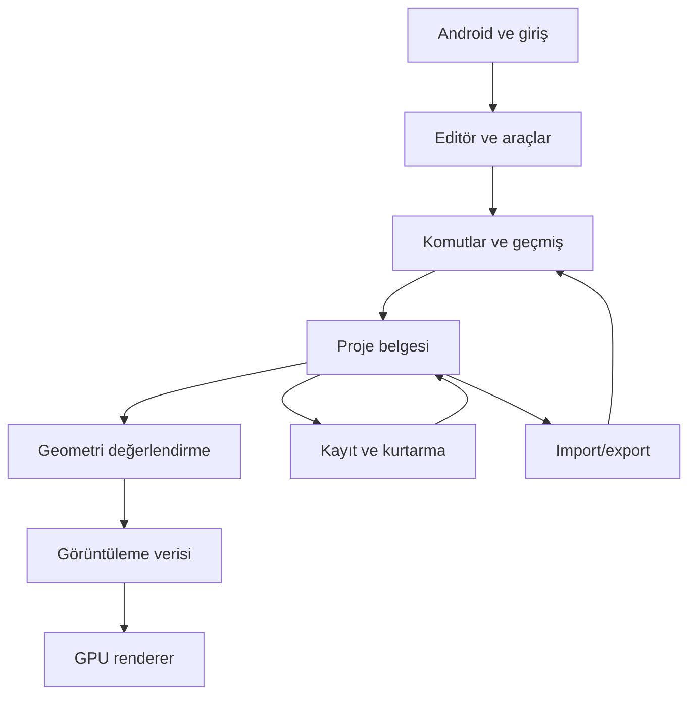

# RUSTBLEND — Profesyonel mimari ve geliştirme ana planı

10 Kasım 2026. GitHub kaynak incelemesine dayanan konuşma planının kalıcı Markdown sürümü.
İncelenen main: `2c22d7e16820d66bea719062e7c7e3c47ca2226c`. Uygulama: 0.4.1.
Tüm çalışmalar mevcut projede, yalnızca `main` üzerinde; test ve APK üretimi GitHub Actions üzerinde yapılır. Yeni dal ve Termux gerektiren akış oluşturulmaz.

## 1. Mevcut durum

Matematik (vektör/matris/quaternion), kamera, doğrulanan vertex/edge/face verisi, küp üretimi, sahne nesneleri ve seçim, wgpu mesh/grid/çizgi çizimi mevcut. Küp ekle/kopyala/sil ve nesne transformları, basit Outliner ve toolbar bağlı. Edit Preview yalnızca topoloji gösterir: gerçek mesh düzenleme değildir. Undo/redo, proje kayıt/açma, import/export ve tam materyal sistemi henüz yoktur.
0.4.0 açılış çökmesi raporlanmıştır. 0.4.1 cihaz sonucu doğrulanmamıştır. Actions #24 başarılıdır; cihaz başarısı anlamına gelmez. Eski PLAN.md içinde tarihi ve güncel durumlar çelişebilmektedir; tarihli kanıtlar ayrı tutulmalıdır.

## 2. Kaynakta görülen sorunlar

| Bulgu | Gerekli değişiklik |
|---|---|
| Scene ve kamera GpuRenderer içinde; suspended renderer'ı siliyor | Belge/editör durumunu GPU yaşam döngüsünden ayır |
| Transformda workspace/geometri yenileniyor | Geometri ve transform kirlenmesini ayrı izle |
| Sürekli redraw | Etkileşim/animasyon dışında ihtiyaç halinde çiz |
| Küçük özel bitmap font | Gerçek font, layout, giriş, erişilebilirlik |
| Triangle fan triangulation | İçbükey poligonlar için sağlam algoritma |
| Mesh elemanları dizi indeksleriyle bağlı | Kararlı kimlikler ve komşuluk |
| Her CI çalışmasında geçici imza | Güvenli kalıcı release imzası |
| debuggable=true ve farklı Cargo/manifest sürümleri | Debug/release ayrımı, tek sürüm kaynağı |

## 3. Hedef mimari

Kullanıcının projesi merkezdir; GPU onun yeniden üretilebilir görüntüsünü taşır.

| Modül | Sorumluluk |
|---|---|
| platform | Android yaşam döngüsü, dosya seçici, klavye, paylaşım |
| document | Proje, sahne, nesne, materyal ve kaynak referansları |
| geometry | Düzenlenebilir topoloji, doğrulama, algoritmalar |
| editor | Seçim, araç, çalışma alanı, önizleme |
| commands | Doğrulanan değişiklikler, transaction, undo/redo |
| evaluation | Modifier, bağımlılık ve önbellek |
| render | CPU görüntüleme verisi |
| gpu | Pipeline, buffer, texture, surface |
| ui | Paneller, font, giriş, erişilebilirlik |
| storage | Sürümlü format, migration, atomik kayıt, kurtarma |
| import_export | Format adaptörleri |
| jobs | Uzun işler, ilerleme, iptal, bütçeler |
| diagnostics | Hata ve performans ölçümü |

Önce modül sınırları kurulur; gerektikçe Cargo workspace crate ayrımı yapılır. Gereksiz yeniden yazım yapılmaz.

## 4. Veri modeli

- [ ] Ayrı ProjectId/SceneId/ObjectId/MeshId/MaterialId türleri; silinen kimliklerin yanlış yeniden kullanımını önleme.
- [ ] Nesne/mesh ayrımı; paylaşılan mesh ve bağımsız kopya.
- [ ] Parent/child, döngü denetimi; local/world transform.
- [ ] Koleksiyon, görünürlük, seçim kilidi.
- [ ] Vertex/edge/face/face-corner özellikleri; köşe başına UV ve normal.
- [ ] Ayrı geometri/transform/materyal/seçim revizyonları.
- [ ] Kalıcı belge/geçici editör ayrımı; GPU önbelleklerini dosyaya yazmama.
- [ ] Birim, koordinat sistemi ve tolerans tanımı.
- [ ] Half-edge/radial komşuluk kararı; non-manifold import ve düzenleme politikası.

## 5. A — Kararlılık ve veri güvenliği

- [ ] 0.4.1 açılışını gerçek logla teşhis et; GPU kurulum aşamalarını kaydet.
- [ ] Vulkan/GLES yollarını ayrı doğrula; kontrollü backend alternatifi.
- [ ] GPU olmadan anlaşılır hata ekranı; native crash ve süreç sonlandırmasını ayrıca ele al.
- [ ] Scene/kamera/editör durumunu renderer dışına çıkar.
- [ ] Suspend/resume, ekran kilidi, yön değişimi ve resize testleri.
- [ ] Surface/device loss kurtarması.
- [ ] Süreç öldürülmesi sonrası disk kurtarması; düşük bellek politikası.
- [ ] Görünmeyen pencereyi çizme; boşta sürekli redraw'u kaldır.
- [ ] Paylaşılabilir tanılama raporu.

Kabul: nesne ekle/taşı, arka plana geç/dön: aynı sahne. Süreç ölümü sonrası kurtarma dosyası açılabilmeli. Rust panic yakalama tüm native çökmeleri engellemez.

## 6. B — Komutlar ve undo/redo

- [ ] Ortak komut, önkoşul ve başarısızlıkta değişmeme garantisi.
- [ ] Transaction; undo/redo; yeni işlemde redo geçmişini temizleme.
- [ ] Tek sürükleme tek adım; önizleme/onay/iptal.
- [ ] Silinen geometri ve referansları geri getirme; seçim/kimlik bütünlüğü.
- [ ] Delta geçmişi, bellek bütçesi ve budama.
- [ ] Kaydedildi/değiştirildi durumu; geçmiş paneli.
- [ ] Komut dizilerini testlerde yeniden oynatma.

Kabul: geri al/yeniden uygula geometri ve kimlikleri beklenen duruma döndürür.

## 7. C — Proje formatı ve kurtarma

- [ ] Sürümlü format, başlık ve bütünlük denetimi.
- [ ] Mesh/nesne/materyal/kaynak kaydı.
- [ ] Yeni/aç/kaydet/farklı kaydet; son projeler ve önizleme.
- [ ] Autosave, dönen yedek, güvenli geçici dosya ve tamamlanma.
- [ ] Başarısız kayıtta eski sağlam dosyayı koruma.
- [ ] Android sağlayıcılarının atomik yazma sınırlamalarını yönetme.
- [ ] Depolama dolu/izin reddi/sağlayıcı kopması.
- [ ] Migration ve yeni sürüm uyumluluk mesajları.
- [ ] Bozuk dosya mevcut projeyi ezmez.
- [ ] Eksik kaynakları bağlama, paketleme, kurtarma ekranı.
- [ ] Dosya boyutu/eleman sayısı/açma süresi sınırları.

Kabul: round-trip içeriği korur; yarım kayıt sağlam projeyi bozmaz.

## 8. D — Mobil UI

- [ ] Telefon/tablet ve portre/yatay düzenler; density ve safe area.
- [ ] Gerçek font, Türkçe karakter, ikon ve açıklamalar.
- [ ] Kaydırılabilir/aranabilir Outliner; adlandırma, görünürlük, kilit.
- [ ] Properties ve sayısal transform/birim girişleri.
- [ ] Aktif araç/seçim göstergesi, bağlamsal menü, komut arama.
- [ ] Undo/redo düğmeleri; ilerleme/iptal.
- [ ] UI/viewport gesture sahipliği; touch cancel temizliği.
- [ ] Klavye/fare/kalem; sol el düzeni.
- [ ] Erişilebilir etiketler, kontrast, ölçeklenebilir metin.
- [ ] Tema ve tercihler.

UI teknolojisi Android üzerinde metin girişi, IME, erişilebilirlik ve GPU uyumu prototipiyle seçilir.

## 9. E — Kamera, seçim, transform

- [ ] Orbit/pan/dolly/pinch; perspektif/ortografik.
- [ ] Altı eksen görünümü, seçime odaklan, sahneyi kadraja al, eksen göstergesi.
- [ ] Ekrandan dünya ışını, nesne picking, BVH.
- [ ] Vertex/edge/face picking ve dokunmatik tolerans.
- [ ] Occlusion/X-ray seçimi; çoklu/kutu/lasso/fırça/loop/ring/bağlı seçim.
- [ ] XYZ ve düzlem gizmo; local/world/normal yönler.
- [ ] Merkez/aktif/bireysel/özel pivot.
- [ ] Grid/vertex/edge/face snap; açı ve ölçek adımları.
- [ ] Sayısal mesafe/açı; onay/iptal.
- [ ] Negatif/sıfıra yakın scale; apply/reset transform.

Kabul: eksende kesin mesafe ve açıyla düzenleme yapılır.

## 10. F — Mesh düzenleme

- [ ] Kararlı topoloji kimlikleri, komşuluk, boundary/non-manifold tespiti.
- [ ] Tutarlı winding, içbükey triangulation, dejenere/kesişen yüzey politikası.
- [ ] Vertex taşı; delete/dissolve; merge/weld; edge split; fill.
- [ ] Extrude, inset, bevel, loop cut.
- [ ] Edge/vertex slide, knife, bridge loops.
- [ ] Subdivide, triangulate, uygun yüzeylerde quad dönüşümü.
- [ ] Normal recalculation/flip; smooth/flat.
- [ ] Separate/join; mirror edit; proportional edit; onarım raporu.

Her işlem boş seçim, açık sınır, bozuk geometri, uç koordinatlar ve undo açısından test edilir.

## 11. G — Primitive ve sahne

- [ ] Plane/cube/circle/UV sphere/icosphere/cylinder/cone/torus/grid.
- [ ] Segment/boyut/yön ve son işlem parametreleri.
- [ ] Parent/unparent, world transform koruma.
- [ ] Koleksiyonlar; linked/independent duplicate.
- [ ] Origin, isolate, çoklu sahne, istatistikler.
- [ ] Mesh/camera/light/empty; sonra curve/armature nesneleri.

## 12. H — Modifier ve değerlendirme

- [ ] Sıralı stack; kaynak ve hesaplanan mesh ayrımı.
- [ ] Artımlı hesaplama, cache, döngü tespiti, viewport/render kalitesi.
- [ ] Aç/kapat/sırala/kopyala/apply.
- [ ] Mirror, array, solidify, bevel, subdivision.
- [ ] Weld, triangulate, decimate, weighted normals.
- [ ] Bend/twist/taper; boolean; remesh.
- [ ] İptal, bellek ve sonuç geometri sınırları.

Boolean/remesh ayrı büyük mühendislik paketleridir; düğme görünmesi tamamlanma değildir.

## 13. I — Materyal, UV, texture

- [ ] Materyal varlıkları ve yüzey ataması; base color/metallic/roughness.
- [ ] Normal/emissive/AO, alpha ve transparency.
- [ ] Texture import, sRGB/linear, mipmap ve bellek bütçesi.
- [ ] UV kanalları ve editörü; vertex/edge/island seçimi.
- [ ] Seam; planar/box/cylindrical/spherical projection; unwrap.
- [ ] Island transform/packing; texel density; stretch/overlap/checker.
- [ ] Eksik texture yönetimi.
- [ ] Sonra painting, normal/AO baking ve materyal nodes.

## 14. J — Renderer

- [ ] Buffer reuse, ayrı GPU transformları, instancing, kısmi upload.
- [ ] Frustum culling ve büyük sahne görünürlüğü.
- [ ] Normal dönüşümü, negatif scale ve winding.
- [ ] Wireframe/solid/material preview, outline, X-ray, overlay.
- [ ] Anti-aliasing, PBR, point/directional/spot light, shadows, HDRI.
- [ ] Tone mapping/renk yönetimi, kalite profilleri.
- [ ] GPU süre/bellek ölçümü, shader doğrulama, görüntü export.
- [ ] İleride progressive/path tracing.

## 15. K — Import/export

- [ ] Önce GLB/glTF; materyal/texture/hiyerarşi/transform eşlemesi.
- [ ] Koordinat/birim dönüşümü ve desteklenmeyen özellik raporu.
- [ ] OBJ, STL; ihtiyaçla PLY.
- [ ] Seçili nesne ve modifier uygulanmış/uygulanmamış export.
- [ ] Geometri doğrulama, ilerleme/iptal, texture paketleme.
- [ ] Bozuk dosya, kaynak tüketimi ve zararlı path sınırları.
- [ ] Başka uygulamada açma; import-export-import testleri.
- [ ] FBX/USD maliyet/lisans değerlendirmesi; .blend ayrı araştırma.

## 16. L — Mobil performans

- [ ] Küçük/orta/büyük benchmark sahneleri; CPU/GPU p95/p99.
- [ ] Sahne/texture/undo bellek bütçeleri; frame allocation temizliği.
- [ ] BVH maliyeti, paylaşılan kaynaklar.
- [ ] Arka plan import/kayıt/modifier; eski iş sonucunu revizyonla reddetme.
- [ ] İptal ve hata dönüşü; ısınma/pil/uzun oturum ölçümleri.
- [ ] Kontrollü kalite düşüşü ve düşük bellek kurtarması.
- [ ] CPU/GPU kaynak yaşam süresi denetimi.

Performans taahhüdü cihaz ölçümüyle belirlenir; 30 FPS etkileşim alt hedefi öneridir, ölçülmüş sonuç değildir.

## 17. M — İleri üretim

- [ ] Timeline/keyframe/interpolation/playback/dope sheet/graph editor.
- [ ] Kemik hiyerarşisi/bind pose/skinning/weights/IK/constraints.
- [ ] Shape keys ve dışa aktarma.
- [ ] Sculpt brushes/symmetry/mask/smooth/multires/remesh/pressure.
- [ ] Retopology, surface snap, shrinkwrap.
- [ ] Bézier curves, bevel/extrude/mesh dönüşümü.
- [ ] Text/font geometrisi ve extrude.
- [ ] Procedural node graph/tür sistemi/cache/döngü denetimi.
- [ ] Önce rigid body, sonra gerekirse cloth/soft body.
- [ ] Compositing ve görüntü çıktısı.

Bunlar modelleme 1.0 sonrasıdır. Profesyonel modelleyici ile tam DCC paketi ayrı hedeflerdir.

## 18. N — Kalite ve dağıtım

- [ ] Matematik/geometri unit ve property testleri; importer/file fuzz.
- [ ] Undo/redo, migration, kesintili kayıt/kurtarma testleri.
- [ ] GPU görüntü ve shader testleri; Android cross-compile.
- [ ] Gerçek Mali/Adreno, yaşam döngüsü ve uzun oturum testleri.
- [ ] fmt/clippy/bağımlılık denetimi; pinlenmiş toolchain.
- [ ] Kalıcı release imzası ve yedekleme; debug/release ayrımı.
- [ ] Tek sürüm kaynağı; commit-APK eşlemesi; checksum/imza doğrulama.
- [ ] Native debug sembolleri; kalıcı release arşivi/değişiklik notları.
- [ ] Yayın tarihinde mağaza şartlarını kontrol et.
- [ ] Lisans/üçüncü taraf lisansları; kılavuz/örnekler/hata şablonu.
- [ ] Dosya uyumluluk ve isteğe bağlı tanılama/gizlilik politikası.

## 19. Kilometre taşları

| Hedef | Sonuç | Kabul |
|---|---|---|
| 0.5 | Açılış, yaşam döngüsü, belge/GPU ayrımı, kurtarma temeli | Arka plandan aynı çalışma döner |
| 0.6 | Komutlar, undo/redo, proje kayıt | Geri al ve yeniden aç |
| 0.7 | Picking, gizmo, sayısal giriş, UI | Hassas düzenleme |
| 0.8 | Gerçek mesh edit araçları | Primitive'den anlamlı model |
| 0.9 | Modifier, UV, materyal, GLB | Başka uygulamada doğru aç |
| 1.0 | Kararlı ve belgeli profesyonel çekirdek | Uzun oturumda güvenilir üretim |
| 1.x | Sculpt, painting, retopology, ileri modifiers | Uçtan uca iş akışları |
| 2.x+ | Animasyon, rigging, procedural, ileri render | Geniş DCC kapsamı |

Bunlar tarih veya tamamlanmış özellik taahhüdü değildir.

## 20. Profesyonellik kabulü

Kullanıcı proje başlatır/açar, hassas modelleme yapar, hatasını geri alır, güvenle kaydeder, geri döner, materyal/UV hazırlar, dışarı aktarır, uzun oturumda kabul edilebilir performans alır. Başarısız işlem projeyi bozmaz; güncelleme eski dosyayı açar.

İlk sıra: açılış teşhisi → sahne/renderer ayrımı → yaşam döngüsünde koruma → kurtarma → komutlar → undo/redo → kalıcı kayıt.

## Kaynaklar

- [Depo](https://github.com/mehmetdem2005/Rustblend)
- [Önceki plan](../PLAN.md)
- [Android yaşam döngüsü](../src/android_app.rs)
- [GPU](../src/gpu.rs), [mesh](../src/geometry/mesh.rs), [render](../src/render.rs), [UI](../src/viewport_ui.rs)
- [Doğrulanmış eski build #24](https://github.com/mehmetdem2005/Rustblend/actions/runs/42289385503)

## Uygulama kaydı — 10 Kasım 2026

İlk kontrollü paket: CPU workspace suspend/resume köprüsü ve yeniden kurulum
başarısızlığında snapshot koruma; nesne işlemleri ve transformlar için 32 adımlık
snapshot geçmişi; tek sürüklemenin tek adım olması; iptal edilen dokunuşta geri
alma; alt şeritte Undo/Redo. Geçmiş de suspend durumuyla taşınır.
Bu henüz delta geçmişi, disk kaydı, tam komut mimarisi veya süreç ölümü kurtarması
değildir. Snapshot maliyeti büyük meshler için ayrıca bütçelenecektir.

CI push üzerinde Rust testleri ve Android hedef kontrolü yapar. APK paketleme,
yalnızca anlamlı cihaz kontrolü aşamasında manuel build_apk=true ile çalışır.
Tek dal main kuralı devam eder. Açılış hatasının gerçek cihaz doğrulaması açıktır.
